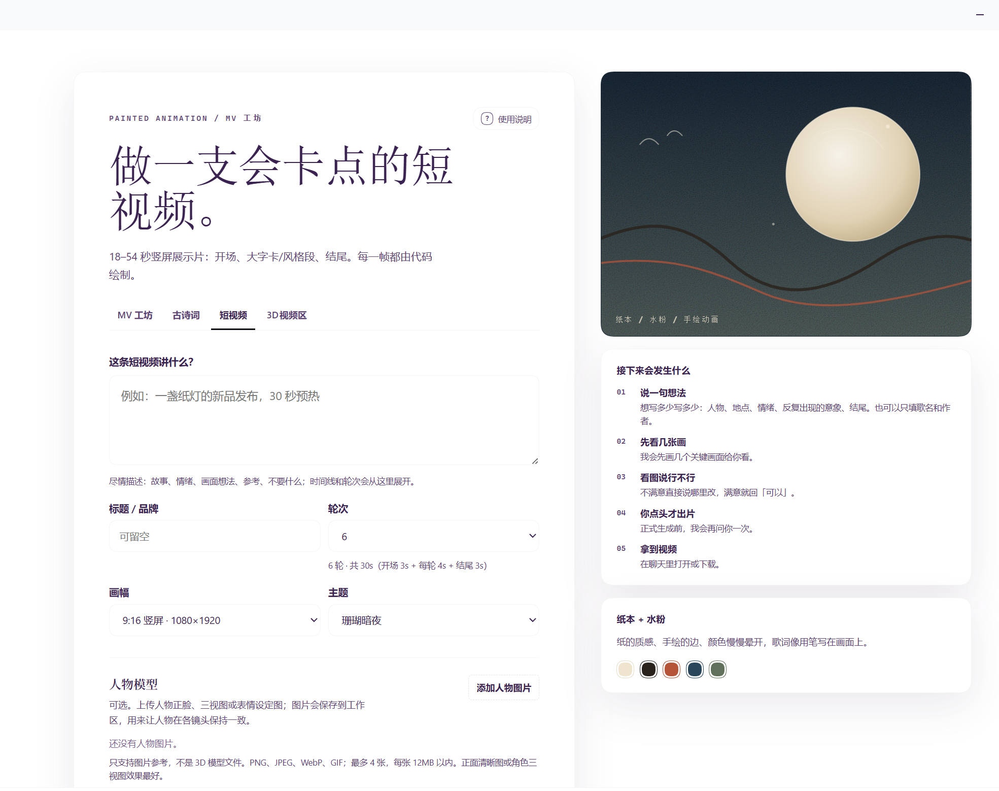
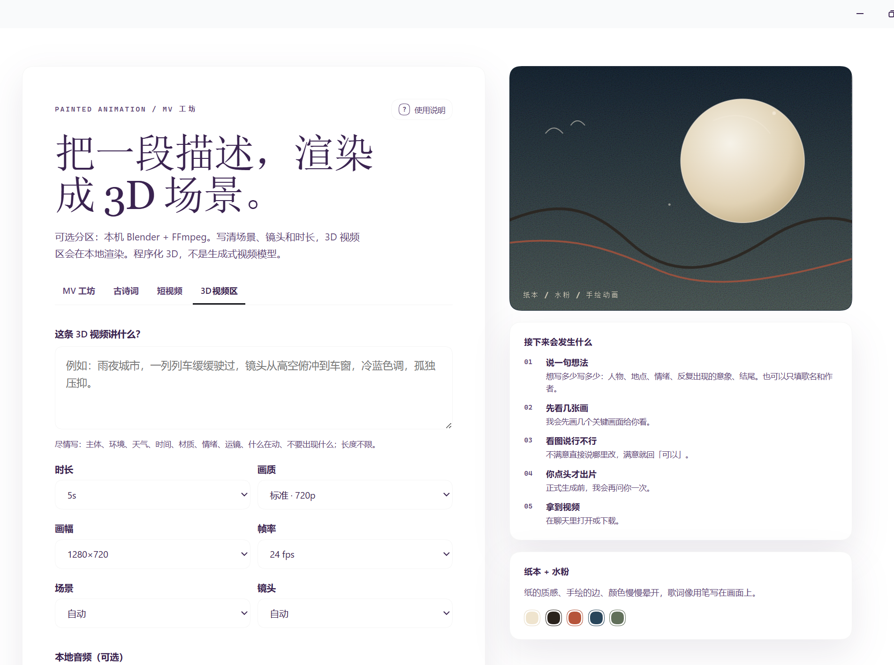

# MV Studio

**DSH 原生 · 程序化手绘动画工作区**

从一段自由描述、一首歌，或一首古诗词开始，完成分镜、镜头审查与本地成片。


## 1. 定位

MV Studio 不是一个“输入提示词、等待视频”的生成器。

它是一套面向手绘动画的创作工作区：先把想法拆成镜头，再把镜头写成可审查的画面，最后在本机渲染为视频。每一步都保留可见的中间状态，每一次修改都能定位到具体镜头。

画面由程序化笔触、纸张纹理、墨线和水彩层次构成，不使用图像或视频生成模型。创作过程不依赖抽卡，而依赖分镜、构图、节奏与逐镜确认。

### 1.1 适用场景

| 场景 | 用途 |
|---|---|
| 音乐短片 / 歌词 MV | 用一句情绪或一首歌建立完整的视觉叙事 |
| 古诗词 / 朗诵短片 | 一句一镜，把诗意拆成可执行的镜头 |
| 角色驱动叙事 | 固定人物造型，完成多镜头连续表演 |
| 视觉提案 / 风格测试 | 先出关键帧与样片，再决定是否扩展为长片 |

### 1.2 产出物

| 产出 | 内容 |
|---|---|
| 分镜 | 镜头表、关键画面、镜头顺序与时长 |
| 审查记录 | 每个镜头的通过状态与修改意见 |
| 成片 | H.264 + AAC 的 MP4 |
| 字幕 | 与歌词同步的 SRT |
| 项目文件 | 可继续修改的镜头与场景代码 |

## 2. 三个手绘模式 + 可选 3D 视频区

### 2.1 MV 工坊

以一段自由描述、一个故事方向，或一首歌为起点。

| 能力 | 说明 |
|---|---|
| 创作方向 | 不限字数；可写人物、故事、情绪、意象、参考与结尾 |
| 歌曲信息 | 可只填歌名与作者，或使用本地音频与 LRC |
| 本地检索 | 歌名/作者仅在本机匹配，不抓取原唱 |
| 歌词同步 | 支持行级 LRC 与逐字歌词 |
| 纯文本歌词 | 没有 LRC 时，可用本机语音识别自动对齐生成 LRC |
| 视频设置 | 目标长度与镜头数可选预设或自定义；默认自动跟随音频 |
| 分镜预览 | 先看关键画面与镜头表，再进入逐镜审查 |
| 镜头审查 | 每个镜头单独确认构图、笔触、动作与连续性 |
| 本地成片 | 输出 MP4 与 SRT 字幕 |

### 2.2 古诗词

一句诗一个镜头，按原诗顺序展开。

| 能力 | 说明 |
|---|---|
| 诗句拆分 | 一行一句，一句一镜；逗号保留在句内 |
| 朗诵 | 支持本机 TTS，或保留表演提示供真人录制 |
| 镜头设计 | 每镜包含画面意境、动态动作、运镜、光影与绘画提示 |
| 风格预设 | 国风水墨、青绿山水、淡彩工笔、月下冷调、秋山暖赭 |
| 自定义风格 | 用颜色、材质、线条、光线与情绪定义任意风格 |
| 首尾呼应 | 分镜阶段要求总视觉构思、母题与首末镜头关系 |

古诗词模式不是把诗句逐字排版，而是把每一句拆成一组镜头语言：

- **意境**：这一句要看见什么，留白在哪里
- **动作**：画面里什么在动，动作为什么发生
- **运镜**：推、拉、摇、移，或保持静止
- **光影**：光源方向、明暗对比、纸面质感
- **绘画提示**：颜色、材质、线条与笔触的作画指令


### 2.3 短视频

面向 18–54 秒的卡点展示片，默认竖屏 9:16。

| 能力 | 说明 |
|---|---|
| 结构公式 | 开场 3s + N 轮 × 4s（大字卡 1s + 风格段 3s）+ 结尾 3s |
| 画幅 | 9:16 竖屏、16:9 横屏、1:1 方形 |
| 主题 | 珊瑚暗夜、橙光白、水蓝莫兰迪、琥珀黑金、蓝图纸、石墨信号、青瓷白、绯墨剧场 |
| 节奏 | 每个风格段从拍点开始，一轮一个意思 |
| 主题描述 | 不限字数；可写故事、情绪、画面想法与参考 |
| 快速审查 | 每轮 5–6 张关键帧，再出 1fps 全片接触表 |



### 2.4 3D视频区（可选）

在 MV 工坊里额外提供一个可选的 3D 分区。它把 DSH Video Studio 的本地 3D 渲染能力接到 MV 工坊的界面里：写一段场景描述，选时长、画质、画幅、帧率、场景和镜头，然后新开一个对话调用 `generate_video`。

| 能力 | 说明 |
|---|---|
| 场景描述 | 不限字数；主体、环境、时间、天气、材质、情绪与运镜 |
| 时长 | 3–30 秒预设（工具支持 1–120 秒） |
| 画质 | draft 快速预览 / standard 720p / high 1080p |
| 画幅 | 960×540 / 1280×720 / 1920×1080 |
| 帧率 | 24 / 30 fps |
| 场景覆盖 | 自动、城市、自然、科幻、太空、海洋、车辆、产品 |
| 镜头覆盖 | 自动、俯冲、跟随、环绕、推进、特写、低角度 |
| 本地音频 | 可选；循环/裁剪到视频长度，不下载网络音乐 |
| 输出 | 本地 Blender + FFmpeg 渲染，返回 MP4 路径 |



要求：先在 DSH 中启用 `@local/dsh-video-studio`。3D视频区不会用其他生成式视频模型替代；如果工具不可用，会明确提示启用 DSH Video Studio。

3D 画面是程序化几何、材质、灯光与摄像机渲染，不是生成式 AI 视频。

## 3. 人物模型

人物一致性是长片动画最难的部分之一。MV Studio 允许为角色建立视觉参考。

- 支持 PNG、JPEG、WebP、GIF
- 最多 4 张参考图
- 可为每张图填写角色名与角色定位
- 图片保存在本机，不随项目上传
- 参考图用于约束角色造型，不会被直接贴进画面

人物仍由程序化笔触绘制，因此同一角色可以在不同镜头、不同光线和不同尺度下保持统一，同时保留手绘质感。

## 4. 镜头级审查

MV Studio 的核心不是“生成”，而是“确认”。

- 分镜阶段先看关键帧与镜头表
- 逐镜检查构图、主体、笔触、动作、歌词与连续性
- 可查看全尺寸画面、局部裁切与首尾帧
- 审查状态与当前源码绑定；内容改动后需要重新确认
- 完整渲染必须由你明确选择后才开始
- 修改单个镜头时只重渲该镜头，不重跑整片

这套流程避免“整片看起来还行，但某个镜头不能用”的情况，也让修改不必从零开始。

## 5. 工作流

### 第一步：选择模式

MV 工坊，或古诗词。

### 第二步：填写内容

MV 模式填写创作方向，可选歌名、作者、音频与歌词；需要时设置目标长度与镜头数。  
古诗词模式填写诗名、作者、诗文与风格。  
短视频模式填写主题、轮次、画幅与主题风格。  
3D 模式填写场景描述，选择画质、画幅、帧率、场景与镜头。

### 第三步：添加人物参考

需要固定角色时，上传人物图并填写角色名与定位。

### 第四步：生成分镜

系统先输出镜头表与关键画面，不直接进入完整渲染。

### 第五步：逐镜确认

对每个镜头给出通过或修改意见；需要时调整构图、动作、光线与节奏。

### 第六步：本地成片

确认后在本机渲染，输出 MP4 与字幕文件。

## 6. 设计原则

### 可审查

每个镜头都有对应的关键画面与审查状态。画面不是黑盒结果，而是可以打开、比较和修改的中间产物。

### 可复现

每一帧由时间驱动，使用确定性种子，不依赖运行时随机状态或计时。相同项目、相同渲染器，得到相同画面。

### 可定位

修改一个镜头，不需要重新生成整段视频。问题可以定位到具体镜头、具体时间点与具体画面元素。

### 本地优先

音频、歌词、人物参考图与项目文件保留在本机。歌名/作者检索不联网抓取原唱。

## 7. 技术基础

- p5.js 与 p5.brush 负责水彩、墨线、纸张与笔触
- 每一帧由时间函数计算，支持精确对齐节拍与歌词
- Headless Chrome 逐帧渲染
- ffmpeg 完成编码与音频合成
- 默认自动选择 GPU，失败时回退软件渲染
- 审查与终版会记录渲染器状态，避免 GPU/软件画面混用

插件内置 `painted-animation` 技能，安装插件后无需再单独安装技能。

## 8. 安装

```powershell
dsh plugin --profile desktop add https://github.com/comlearner834/dsh-plugin-mv-studio
```

将 `desktop` 替换为你的 DSH profile，例如 `web`。

安装后：

1. 打开 DSH「插件」页
2. 启用 **MV Studio**
3. 重启 DSH 或刷新页面

## 9. 环境

- DeepSeek Harness（DSH）桌面版或 Web 版
- Node.js
- Google Chrome
- ffmpeg

首次渲染前请确认本机已具备上述环境。首次创建项目时，插件会自动安装项目依赖，不需要手动执行 `npm install`。音频、歌词、人物参考图与项目文件均保留在本机。

## 10. 数据与隐私

- 歌名/作者只在本机检索
- 不下载版权音频或歌词
- 人物参考图保存在本机
- 项目文件、审查记录与成片保留在本地项目目录
- 完整渲染不会自动开始

## 11. 常见问题

**需要单独安装 painted-animation 技能吗？**  
不需要。技能已随插件打包，首次启动会自动安装到 DSH 的 skills 目录。

**会上传歌曲、歌词或人物图吗？**  
不会。歌名/作者只在本机检索；音频、歌词与人物参考图保存在本机。

**可以直接生成完整视频吗？**  
流程会先出分镜和关键画面，逐镜确认后才进入完整渲染。

**人物参考图会直接出现在画面里吗？**  
不会。参考图用于约束角色造型，最终画面仍由程序化笔触绘制。

## 12. 许可

MIT

目前正在不断优化中。
