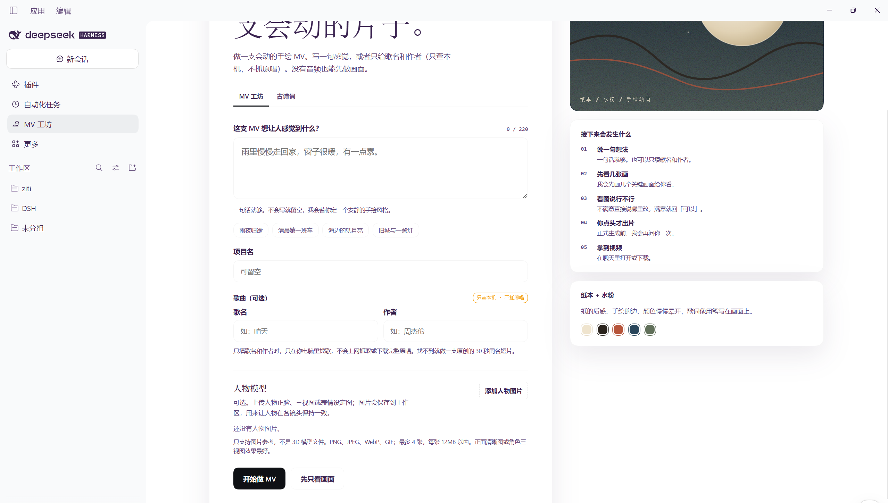
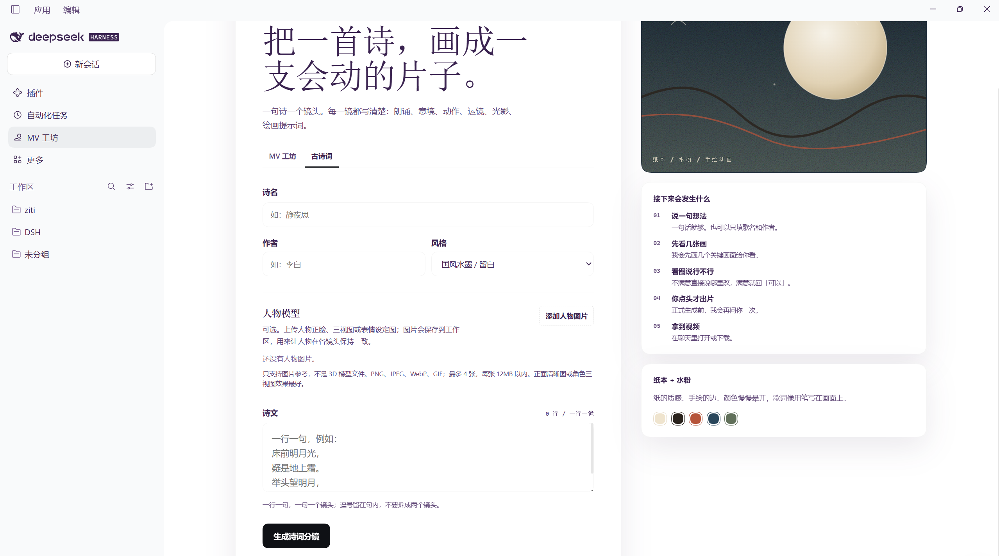

# MV Studio

DSH 侧边栏里的手绘 MV 创作面板：从一句感觉或一首歌开始，也可以把一首古诗词逐句画成镜头。



## 功能

### MV 工坊

- 写一句创作方向，或只填歌名和作者
- 支持本地音频、LRC、逐字歌词
- 先出分镜和关键画面，再逐镜审查
- 明确选择后才开始完整渲染

### 古诗词

- 一句诗一个镜头，按原诗顺序
- 每镜生成朗诵、画面意境、动态动作、运镜、光影和绘画提示
- 内置国风水墨、青绿山水、淡彩工笔、月下冷调、秋山暖赭
- 支持自定义风格：颜色、材质、线条、光线、情绪



### 人物模型

- 每个分区都可以上传人物参考图
- 最多 4 张，支持 PNG、JPEG、WebP、GIF
- 可填写角色名和角色定位
- 图片保存在本机，作为角色一致性参考

### 本地优先

- 歌名/作者只在本机查找，不抓取原唱
- 图片和项目文件留在本机
- 完整渲染由你明确确认后才开始

## 安装

在 DSH 中执行：

```powershell
dsh plugin --profile desktop add https://github.com/comlearner834/dsh-plugin-mv-studio
```

把 `desktop` 换成你的 DSH profile（例如 `web`）。然后在 DSH 的「插件」页启用 **MV Studio**，重启 DSH 或刷新页面。

本地开发时也可以直接安装目录：

```powershell
dsh plugin --profile desktop add D:\path\to\dsh-plugin-mv-studio
```

## 使用

1. 点击左侧「MV 工坊」
2. 选择「MV 工坊」或「古诗词」
3. 填写内容；需要固定人物时上传人物参考图
4. 点击「开始做 MV」或「生成诗词分镜」
5. 先看分镜，再逐镜确认

## 要求

- DeepSeek Harness（DSH）桌面版或 Web 版
- 已安装 `painted-animation` 技能

## 许可证

MIT
